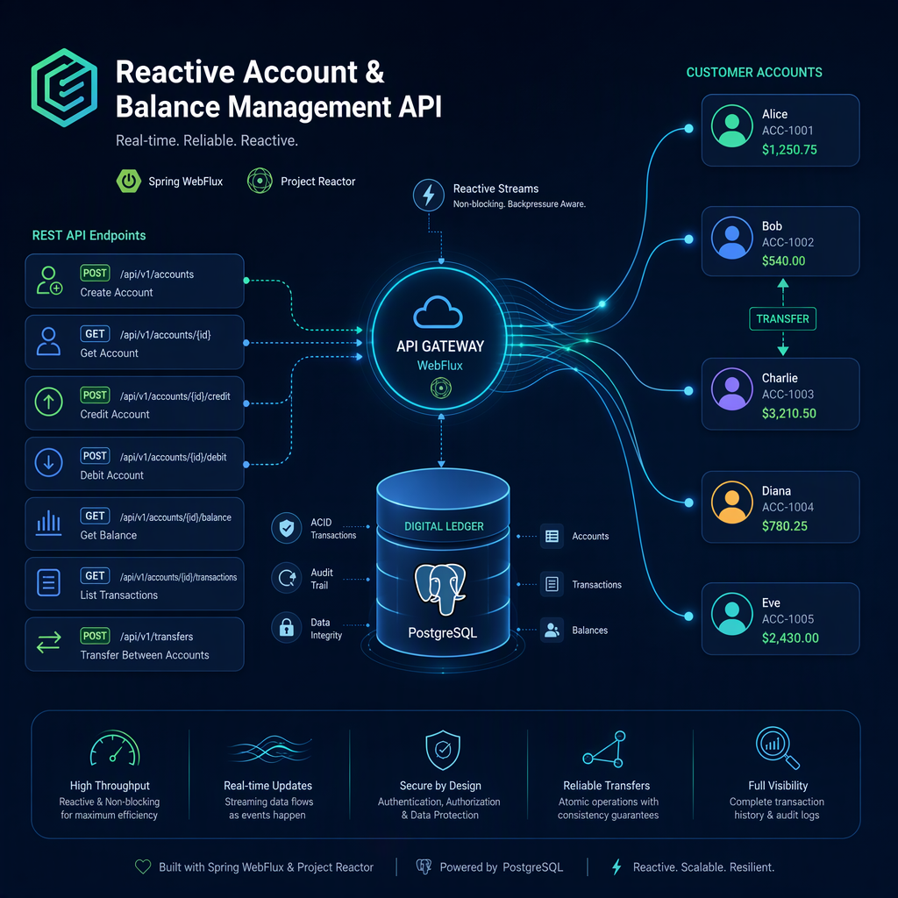

# Service Balance

<p align="center">
    
</p>

Service Balance is a Java Spring Boot backend for managing account-related transaction workflows. It uses Project Reactor to expose reactive APIs for creating and retrieving transfer transactions.

## Features

- Create transfer transactions with a `PENDING` status.
- Retrieve all transfer transactions.
- Validate source and destination accounts.
- Reject transfers with invalid amounts or insufficient source account balance.
- Document API endpoints using OpenAPI annotations.

## Technology Stack

- Java
- Spring Boot
- Spring WebFlux
- Project Reactor (`Mono` and `Flux`)
- Jakarta Validation
- OpenAPI / Swagger annotations

## Transfer Transaction Workflow

When a transfer transaction is requested, the service:

1. Validates the request parameters.
2. Ensures the source and destination accounts are different.
3. Looks up the source account.
4. Checks that the requested amount does not exceed the source account balance.
5. Looks up the destination account.
6. Saves the transfer transaction with:
    - A `PENDING` status
    - The requested amount
    - Source and destination account IDs
    - Creation and update timestamps

> Creating a pending transfer transaction does not deduct, reserve, or transfer account balances. Actual balance updates must be handled separately.

## Validation Rules

A transfer request must satisfy all the following:

- `sourceAccountId` must be provided.
- `destinationAccountId` must be provided.
- `transactionMethod` must be provided.
- `amount` must be provided and greater than zero.
- Source and destination account IDs must be different.
- Both accounts must exist.
- The amount must not exceed the source account balance.

An amount equal to the source account balance is allowed.

## API Endpoints

The API prefix is configured through the `base-url` property.

The examples below assume:

```properties
base-url=/api
```

### Create a Transfer Transaction

```http
POST /api/transfer-transactions/create-transfer-transaction/
Content-Type: application/json
```

#### Request Fields

| Field                  | Required | Description                                              |
|------------------------|----------|----------------------------------------------------------|
| `sourceAccountId`      | Yes      | Identifier of the source account                         |
| `destinationAccountId` | Yes      | Identifier of the destination account                    |
| `transactionMethod`    | Yes      | A valid transaction method supported by the application  |
| `amount`               | Yes      | Positive amount not exceeding the source account balance |

Use account identifiers and a transaction method value matching the types defined in the application's request DTO.

#### Successful Response

**Status:** `201 Created`

```json
{
  "title": "Success",
  "explanation": "Transfer transaction created successfully"
}
```

#### Error Responses

| Status            | Condition                                                           |
|-------------------|---------------------------------------------------------------------|
| `400 Bad Request` | Missing required parameters or an amount less than or equal to zero |
| `400 Bad Request` | Source and destination accounts are the same                        |
| `400 Bad Request` | Amount exceeds the source account balance                           |
| `404 Not Found`   | Source account does not exist                                       |
| `404 Not Found`   | Destination account does not exist                                  |

Error messages raised by the service include:

```text
Invalid transaction parameters; amount must be greater than 0
Source and destination accounts must be different
Insufficient source account balance
Source account not found
Destination account not found
```

The HTTP error response body depends on the application's error-handling configuration.

### Retrieve Transfer Transactions

```http
GET /api/transfer-transactions/retrieve-transfer-transactions/
```

**Status:** `200 OK`

Returns a JSON array of transfer transactions containing:

- `id`
- `createdAt`
- `updatedAt`
- `amount`
- `sourceAccountId`
- `destinationAccountId`
- `transactionStatus`

If no transfer transactions exist, the endpoint returns an empty array:

```json
[]
```

## Project Structure

Relevant packages:

```text
src/main/java/com/backend/serviceBalance/
├── accounts/
│   └── repositories/
│       └── AccountRepository.java
├── transactions/
│   ├── controllers/
│   │   └── TransferTransactionController.java
│   ├── models/
│   │   ├── TransferTransaction.java
│   │   └── enums/
│   │       └── TransactionStatus.java
│   ├── payloads/
│   │   ├── requests/
│   │   │   └── CreateTransferTransactionRequest.java
│   │   └── responses/
│   │       └── TransferTransactionResponse.java
│   ├── repositories/
│   │   └── TransferTransactionRepository.java
│   └── services/
│       └── TransferTransactionService.java
└── utils/
    └── GeneralResponse.java
```

## Getting Started

### Prerequisites

- A JDK compatible with the project's build configuration
- Maven or Gradle, depending on the build file included in the repository
- Access to the database and any other infrastructure configured by the application

### Configuration

Before starting the application:

1. Configure the database connection in `application.properties`, `application.yml`, or environment variables.
2. Set the API prefix using `base-url`.
3. Configure the server port if needed.

Example API and server configuration for .env file (.env file like below is required):

```properties
APPLICATION_HOST=127.0.0.1
APPLICATION_PORT=8000
DATABASE_HOST=localhost
DATABASE_PORT=5432
DATABASE_NAME=YOUR_DATABASE_DB
DATABASE_USER=YOUR_DATABASE_USERNAME
DATABASE_PASSWORD='YOUR_DATABASE_PASSWORD'
BASE_URL=/api
APPLICATION_VERSION=0.0.1-SNAPSHOT
APPLICATION_NAME='Service Balance'
MAX_RETRY=2
MAX_DURATION_TIMEOUT=3
```

Database settings depend on the persistence technology configured in the project.

### Run the Application

Use the command matching the build tool included in your repository.

#### Maven Wrapper

```bash
./mvnw spring-boot:run
```

#### Gradle Wrapper

```bash
./gradlew bootRun
```

On Windows, use `mvnw.cmd` or `gradlew.bat`.

With the example configuration above, the application is available at:

```text
http://localhost:8080
```

## API Documentation

The transfer controller includes OpenAPI annotations describing request fields, response schemas, and HTTP status codes.

If Swagger UI is enabled through the project's OpenAPI configuration, use its configured URL to explore and test the endpoints.

## Testing

Run tests using the project's build tool:

```bash
# Maven
./mvnw test

# Gradle
./gradlew test
```

Recommended test cases include:

- Creating a valid transfer transaction
- Rejecting missing required fields
- Rejecting zero or negative amounts
- Rejecting identical source and destination accounts
- Rejecting nonexistent accounts
- Rejecting an amount greater than the source balance
- Allowing an amount equal to the source balance
- Verifying that newly created transactions have a `PENDING` status
- Retrieving an empty transaction list

## Implementation Notes

### Balance Consistency

The balance validation performed during transaction creation is a point-in-time check. It does not prevent multiple pending transactions from collectively exceeding the available balance.

When implementing actual transfer execution, validate and update balances atomically using concurrency controls appropriate to the configured database.

### Transaction Method

The current service validates that `transactionMethod` is present, but the shown transaction builder does not persist it.

If transaction methods need to be retained, add the field to the transaction model and save it during creation.

## License
This project is licensed under the [MIT License](./LICENSE).

## Contact
Hesam Davarpanah - hesamdavarpanah@gmail.com

## Q&A

## Architecture and Design Decisions

### Technologies

#### Which technologies are used?

Service Balance uses:

- **Java and Spring Boot** for backend development.
- **Spring WebFlux and Project Reactor** for reactive request processing.
- **Spring Data R2DBC** for reactive database access.
- **PostgreSQL** for persistent storage, transactions, and row-level locking.
- **Docker** for packaging and simplifying deployment.
- **Resilience4j** for circuit breaker support.
- **Reactor Retry** for configurable retries with exponential backoff and jitter.

#### Why were these technologies selected?

**Docker** simplifies application setup by packaging the application and its dependencies into a consistent environment. Users still need a compatible container runtime, but do not need to install every application dependency individually.

**PostgreSQL** provides:

- Persistent storage for accounts and transactions.
- Database transactions with commit and rollback.
- Row-level locking for concurrent balance updates.
- Data integrity through primary keys, unique constraints, and other SQL constraints.

**Reactive Spring and R2DBC** support asynchronous, non-blocking I/O across the HTTP and database layers.

Reactive execution does not necessarily mean multithreaded execution. Its main advantage for this application is handling I/O without blocking a thread while waiting for completion.

#### What trade-offs do these technologies introduce?

- Database development and maintenance require basic SQL knowledge.
- Docker requires a supported container runtime; some environments require virtualization support.
- Reactive code introduces additional complexity in debugging and transaction management.
- Row-level locking protects data consistency but can increase waiting time under contention.
- Retries improve resilience to transient failures but can increase response latency and database load.

## Architecture

### What is the overall solution structure?

Service Balance follows a layered reactive architecture:

HTTP Client
→ Controller
→ Service and Validator
→ Reactive Repository / R2dbcEntityTemplate
→ PostgreSQL

Database-changing workflows are wrapped in a reactive transaction using
`TransactionalOperator`.

### What are the main system components?

- **Controllers:** Receive HTTP requests and return API responses.
- **Validators:** Validate operation inputs and business constraints.
- **Services:** Implement credit, debit, transfer, and balance retrieval workflows.
- **Repositories:** Read and update account and transaction data.
- **R2dbcEntityTemplate:** Inserts new transaction records.
- **TransactionalOperator:** Defines reactive database transaction boundaries.
- **Retry policy:** Determines which failures can be retried.
- **Circuit breaker:** Limits execution when the configured breaker is open.
- **PostgreSQL:** Stores data and provides transaction and locking guarantees.

## Same-Account Transfers

### What happens when the source and destination accounts are the same?

Same-account transfers are rejected by the transfer validation rule.

No balance changes should be performed for an invalid request.

This follows the expected business rule for bank-style transfers: the source and destination accounts must be different.

The HTTP status and response body depend on the application's exception-handling configuration.

## Concurrency

### How is concurrent data consistency ensured?

The implementation uses **pessimistic row-level locking**:

SELECT *
FROM accounts
WHERE id = :accountId
FOR UPDATE

Account rows are locked before their balances are checked or updated.

Existing transaction records are also retrieved using `SELECT ... FOR UPDATE`.

These operations run inside a database transaction managed by
`TransactionalOperator`. PostgreSQL holds the row locks until the transaction ends.

This protects the read-check-update workflow across concurrent requests and application instances, provided all competing balance-writing paths follow a compatible locking strategy.

The implementation does not rely on Java-level synchronization or thread-blocking calls for data consistency.

### Why was this approach selected?

Row-level locking prevents concurrent operations from modifying the same account based on an outdated balance.

It makes balance validation and subsequent updates consistent within the database transaction.

Duplicate execution is addressed separately through transaction identifiers, operation matching, status checks, and transaction-record locking.

### What happens when concurrent operations target the same account?

Requests targeting the same locked account generally wait for the current transaction to finish.

After acquiring the lock, each request reads the current account state and continues validation.

Therefore:

- Multiple distinct valid operations may succeed sequentially.
- A debit may fail if an earlier operation leaves insufficient balance.
- Repeated execution of a completed transaction is rejected.
- Lock-related transient failures may be retried if classified as retryable.

Concurrency alone does not imply that all but one request receive `409 Conflict`. HTTP error statuses are determined by the exception-handling layer.

## Idempotency

### How is repeated execution of a transaction prevented?

The supplied `transactionId` identifies the operation.

During credit, debit, or transfer execution, the service:

1. Locks the relevant account rows.
2. Reads and locks the existing transaction, if present.
3. Creates a `PENDING` transaction if no record exists.
4. Verifies that the stored operation matches the requested operation.
5. Rejects a transaction that is already `SUCCESS`.
6. Applies balance changes and records `SUCCESS` in the same database transaction.

For credit and debit, operation matching checks:

- Account ID
- Amount
- Transaction method

For transfers, operation matching checks:

- Source account ID
- Destination account ID
- Amount

Reusing an existing transaction ID with different operation details raises
`IdempotencyConflictException`.

Repeating a completed transaction raises
`TransactionAlreadyCompletedException`.

This provides duplicate-execution protection rather than replaying the original successful response.

### What happens if the same transaction is received concurrently?

For identical requests affecting the same account rows, row-level locks serialize processing.

Once the first request commits successfully, a later request observes the
`SUCCESS` status and does not apply the balance changes again.

Transaction IDs must also be enforced as primary keys or unique values in the database. This is essential when competing requests attempt to insert the same ID without locking the same account rows.

A missing transaction row cannot be protected by `SELECT ... FOR UPDATE`; database uniqueness handles competing inserts.

Credit/debit transactions and transfer transactions are stored in separate tables. Global uniqueness across both tables is not established by this service code alone.

## Transfer Atomicity

### How is transfer atomicity guaranteed?

Transfer execution runs inside one reactive database transaction using
`TransactionalOperator`.

The transaction includes:

1. Locking both account rows.
2. Reading or creating the transfer transaction.
3. Validating operation details and transaction status.
4. Checking the source balance.
5. Calculating the destination balance with overflow protection.
6. Debiting the source account.
7. Crediting the destination account.
8. Updating the transfer status to `SUCCESS`.

All database changes commit together.

If an operation fails before successful commit, the transaction is rolled back, preventing a partially completed transfer.

Row-level locks provide concurrency control; the database transaction provides atomicity.

### How are invalid balance operations handled?

The implementation rejects:

- Invalid or negative stored balances.
- Non-positive transaction amounts.
- Debits or transfers exceeding the source balance.
- Credit or destination balance overflow.

Destination balance calculations use `Math.addExact` to detect numeric overflow.

The transfer status update must affect exactly one row. Otherwise, the service raises an error and the transaction is rolled back.

## Deadlocks

### Can deadlocks occur?

Deadlocks remain possible in a database application, particularly when other workflows acquire locks in incompatible orders.

However, this implementation reduces transfer-related deadlock risk by locking accounts in a consistent order.

### How does the implementation reduce deadlock risk?

Before acquiring transfer account locks, the service compares the account IDs and locks them in ascending lexicographic order.

This means opposite-direction transfers between the same accounts acquire their account locks in the same order.

PostgreSQL detects deadlocks and aborts one of the involved transactions.

The retry mechanism can retry such failures if `CreditRetryPolicy` classifies them as retryable.

Consistent account lock ordering reduces risk but is not a guarantee that every possible deadlock is eliminated.

## Retry, Timeout, and Circuit Breaker

### How are transient failures handled?

Credit, debit, and transfer operations use configurable retries with:

- Exponential backoff starting at 200 milliseconds.
- A maximum backoff of 2 seconds.
- Jitter of 0.5.
- A maximum retry count configured through `max-retry`.
- A timeout configured through `max-duration-timeout`.

Each retry starts a new transactional execution attempt.

The exact retryable failure categories are defined by `CreditRetryPolicy`.

### Which failures are not retried?

The retry filters explicitly exclude:

- Idempotency conflicts.
- Already-completed transactions.
- Insufficient balance errors for debit and transfer.
- Illegal argument errors for transfer.

Other failures are retried only if the retry policy accepts them.

### How is the circuit breaker applied?

The credit, debit, and transfer execution pipelines use the configured
`creditCircuitBreaker`.

The circuit breaker wraps the retry pipeline and can reject execution when it is open, according to its configuration.

## HTTP Error Mapping

The service raises domain exceptions for conflicts, completed transactions, insufficient funds, and invalid operations.

The HTTP response status and body are defined by the application's exception handler.

For example, an application may map idempotency conflicts or already-completed transactions to `409 Conflict`, but this mapping must be explicitly implemented.

## AI Conversation

### **For this project, AI used. To see my conversation with AI see [AI Conversation](./Service%20Balance_2026-11-09_22-06-06.md)**
